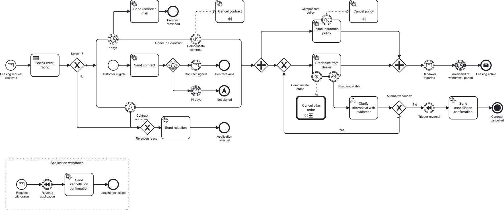

# Fullstack Bike-Leasing Blueprint [](https://github.com/miragon-blueprints/fullstack-example/actions/workflows/pre-merge.yml) [](LICENSE)

One opinionated way to start a greenfield process-automation project, wired end to end: one BPMN
process automated with a [CIB seven](https://cibseven.org) (community Camunda 7) **embedded engine**,
a **React frontend**, and an **AI-agent setup**, with an architecture kept honest by tests. It is a
work-in-progress **solution template** to fork and build on, not a product that ships.

## The process



**MiraVelo** is a (fictional) lifestyle bike brand that leases gravel and road bikes. The process
takes a leasing application from first request to active lease (credit check, contract signing,
insurance, and bike order, plus timers, a DMN decision, compensation, and a back-office inbox for the
awkward cases): a customer submits an application, watches the case advance on its own, signs the
contract when asked, and if the bike is out of stock an agent picks an alternative in `/aufgaben`.

## Quick start

Requirements: JDK 21, Node ≥ 22.12, Docker (or Podman).

```bash
docker compose -f stack/docker-compose.yml up -d   # Postgres
./gradlew :service:app:bootRun                      # backend + engine on :8080
npm --prefix frontend ci && npm --prefix frontend run dev   # UI on :5173
```

| What | URL | Login |
|---|---|---|
| Frontend | <http://localhost:5173> | – |
| CIB seven webclient | <http://localhost:8080/webapp> | admin/admin |
| CIB seven Cockpit | <http://localhost:8080/camunda> | admin/admin |
| Swagger UI | <http://localhost:8080/swagger-ui.html> | – |

API scenarios against the running stack: `cd bruno && npx --yes @usebruno/cli@4.0.0 run . --env local -r`.
The full dev loop (verification, containers, Playwright, contract regeneration) is in
[CONTRIBUTING.md](CONTRIBUTING.md).

## What's inside

| Path | Content |
|---|---|
| [`service/app`](service/app) | Hexagonal Kotlin / Spring Boot backend with the embedded CIB seven engine |
| [`service/common-architecture-tests`](service/common-architecture-tests) | ArchUnit + Konsist rules that fail the build |
| [`openapi/openapi.json`](openapi/openapi.json) | Generated, committed, drift-gated REST contract |
| [`frontend`](frontend) | React, Feature-Sliced Design, Tailwind, TanStack; Playwright specs in `e2e/` |
| [`bruno`](bruno) | API scenario collections |
| [`stack`](stack) | `docker-compose.yml` (dev DB) · `docker-compose.full.yml` (full stack) |
| [`docs`](docs/README.md) | Docs index and [ADRs](docs/adr/) explaining why it's shaped this way |
| [`.claude`](.claude) · [`AGENTS.md`](AGENTS.md) | AI guidance: 8 skills, 2 review subagents |
| [`.github/workflows`](.github/workflows) | Pre-merge (parallel jobs) and nightly pipelines |

## Contributing

Contributions welcome: see [CONTRIBUTING.md](CONTRIBUTING.md) and use [Conventional Commits](https://www.conventionalcommits.org).

## License

[MIT](LICENSE)
